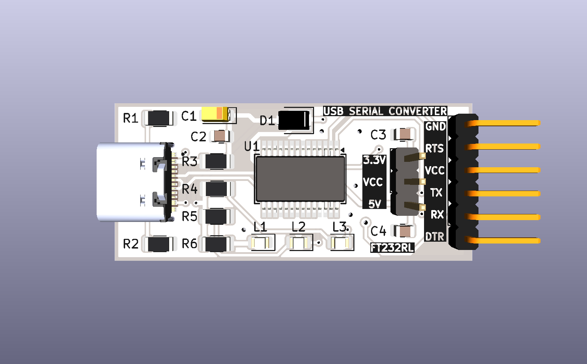
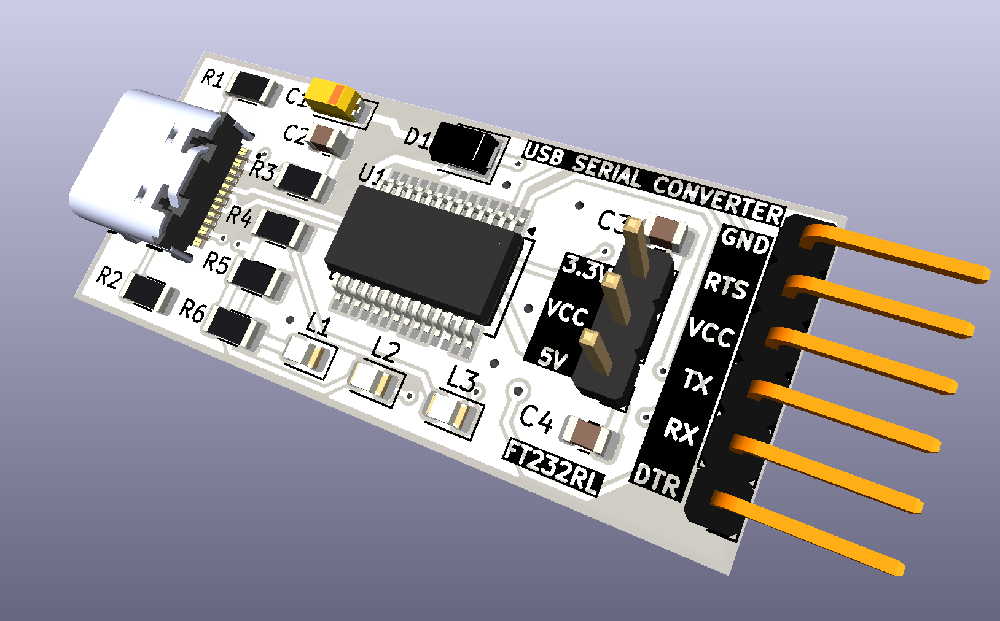

<div align="center">



# FTDI232 COM RTS

**Conversor USB-Serial compacto com conector USB-C, chip FT232RL, seleção de tensão 3,3V / 5V, 3 LEDs de status e saída com pino RTS — totalmente SMD**

[](https://www.kicad.org/)
[](.)
[](.)
[](.)
[](.)
[](.)
[](.)

</div>

---

## 📋 Índice

- [FTDI232 COM RTS](#ftdi232-com-rts)
  - [📋 Índice](#-índice)
  - [Visão Geral](#visão-geral)
  - [Renders 3D](#renders-3d)
  - [Funcionalidades](#funcionalidades)
  - [Diagrama de Blocos](#diagrama-de-blocos)
  - [Especificações Técnicas](#especificações-técnicas)
  - [Lista de Materiais](#lista-de-materiais)
  - [Pinagem dos Conectores](#pinagem-dos-conectores)
    - [J2 — Saída Serial (6 pinos angulado)](#j2--saída-serial-6-pinos-angulado)
    - [JP1 — Seleção de Tensão](#jp1--seleção-de-tensão)
  - [Seleção de Tensão — JP1](#seleção-de-tensão--jp1)
  - [Aplicações](#aplicações)
  - [Estrutura do Repositório](#estrutura-do-repositório)
  - [Como Usar](#como-usar)
    - [Conexão com Arduino (programação)](#conexão-com-arduino-programação)
    - [Conexão com ESP8266 / ESP32](#conexão-com-esp8266--esp32)
    - [Instalação de drivers](#instalação-de-drivers)
  - [Sobre](#sobre)

---

## Visão Geral

**FTDI232 COM RTS** é um módulo conversor **USB para Serial (UART)** compacto e totalmente SMD, projetado pela **ZAT ELECTRONIC** utilizando **KiCad 10**. O módulo é baseado no chip **FT232RL** (SSOP-28), reconhecido automaticamente pelo sistema operacional sem necessidade de drivers adicionais na maioria das plataformas.

O diferencial deste módulo em relação a conversores convencionais é a presença do **pino RTS** no conector de saída de 6 pinos, além do tradicional conjunto **GND / VCC / TX / RX / DTR**. A tensão de saída é selecionável entre **3,3V e 5V** via jumper **(JP1)**, tornando o módulo compatível com uma ampla variedade de microcontroladores e módulos seriais. A entrada USB utiliza o conector **USB-C** (USB4105GFA SMD).

> 💡 Ideal para programação de Arduino bootloader, ESP8266, ESP32 sem USB nativo, módulos GSM, GPS e qualquer dispositivo com interface UART.

---

## Renders 3D

<div align="center">


*Vista superior — FT232RL SSOP-28, USB-C, LEDs SMD 0805, jumper JP1 e conector de 6 pinos (render da versão original)*

<br/>



*Vista isométrica — layout compacto SMD com saída de 6 pinos angulada*

</div>

---

## Funcionalidades

- ✅ **Chip FT232RL** (SSOP-28 SMD) — conversor USB-Serial com oscilador e EEPROM internos
- ✅ **Conector USB-C** (USB4105GFA) — USB 2.0, resistores de 5,1 kΩ no CC1/CC2 (R1, R2)
- ✅ **Seleção de tensão 5V / 3,3V** via jumper JP1 — define o pino VCC do J2 **e o VCCIO do FT232RL** (nível lógico das saídas)
- ✅ **Pino RTS** disponível no conector de saída
- ✅ **Pino DTR** disponível — reset automático de Arduino e bootloaders
- ✅ **3 LEDs SMD 0805** — D2 alimentação, D3 TX (CBUS0), D4 RX (CBUS1)
- ✅ **Diodo Schottky SS1P3L** (D1, DO-220AA SMD) — proteção contra corrente reversa entre VBUS e +5V
- ✅ **Capacitor de tântalo 10µF/16V** (C2, EIA-3216 SMD) + 100nF (C1) — filtragem da entrada VBUS
- ✅ **Desacoplamento do FT232RL** — 100nF no VCC (C3) e 1µF no 3V3OUT (C4), 0805 SMD
- ✅ **Resistores 1206 SMD** — R1/R2 5,1 kΩ (CC), R3 0 Ω (VBUS), R4–R6 1 kΩ (LEDs)
- ✅ **Saída por barra de 6 pinos 90°** (J2) na borda da placa

---

## Diagrama de Blocos

```
┌─────────────┐       ┌──────────────────┐       ┌─────────────────────────┐
│  USB-C  J1  │       │   FT232RL  U1    │       │  J2 (6 pinos 90°)       │
│ USB4105GFA  │──────►│   SSOP-28        │──────►│  1 DTR                  │
│  D+ / D-    │  USB  │  TXD/RXD/DTR/RTS │       │  2 RXD (entrada)        │
└──────┬──────┘       │  CBUS0 / CBUS1   │       │  3 TXD (saída)          │
       │ VBUS         │  VCCIO ◄── VOUT  │       │  4 VCC = VOUT           │
   R3 0Ω → D1 SS1P3L  └──────────────────┘       │  5 RTS                  │
       → +5V (VCC)            │ 3V3OUT           │  6 GND                  │
                          [JP1] 1-2 = 5V  /  2-3 = 3,3V → VOUT
                                                 └─────────────────────────┘
   D2 PWR (+5V)    D3 TX (CBUS0)    D4 RX (CBUS1)
```

---

## Especificações Técnicas

| Parâmetro | Valor |
|-----------|-------|
| **Chip conversor** | FT232RL (SSOP-28 SMD) |
| **Conector USB** | USB-C — USB4105GFA (USB 2.0) |
| **Tensão de saída / nível lógico** | 5V ou 3,3V (JP1 → VOUT = VCC do J2 e VCCIO do FT232RL) |
| **Saída 3,3V** | regulador interno do FT232RL (3V3OUT) — até ~50 mA |
| **Pinos do J2** | DTR, RXD, TXD, VCC, RTS, GND |
| **LEDs de status** | 3x SMD 0805 — D2 PWR, D3 TX, D4 RX |
| **Diodo de proteção** | SS1P3L — Schottky (DO-220AA SMD) |
| **Capacitor de entrada** | 10µF / 16V tântalo (EIA-3216) + 100nF |
| **Capacitores do FT232RL** | 100nF (VCC) e 1µF (3V3OUT), 0805 SMD |
| **Resistores** | 0Ω, 1kΩ, 5,1kΩ (1206 SMD) |
| **Jumper de tensão** | JP1 — 3 pinos 2,54mm (header vertical) |
| **Conector de saída** | J2 — 6 pinos 90° 2,54mm na borda |
| **Placa** | 41,7 × 18,4 mm, 2 camadas |
| **Ferramenta de Projeto** | KiCad 10 |

---

## Lista de Materiais

| Ref | Componente | Valor / Parte | Encapsulamento |
|-----|-----------|--------------|----------------|
| U1 | Conversor USB-Serial | FT232RL | SSOP-28 SMD |
| J1 | Conector USB | USB-C (USB4105GFA) | SMD + furos de fixação |
| J2 | Conector de Saída | 6 pinos — DTR/RXD/TXD/VCC/RTS/GND | Barra 90° 2,54mm |
| JP1 | Jumper de Tensão | 5V / VOUT / 3,3V | Header 3 pinos 2,54mm |
| D1 | Diodo Schottky | SS1P3L | DO-220AA (SMP) |
| D2 | LED PWR | LED 0805 | 0805 |
| D3 | LED TX | LED 0805 | 0805 |
| D4 | LED RX | LED 0805 | 0805 |
| C1 | Capacitor cerâmico (VBUS) | 100nF | 0805 SMD |
| C2 | Capacitor de tântalo (VBUS) | 10µF / 16V | EIA-3216-18 (A) |
| C3 | Capacitor cerâmico (VCC do FT232RL) | 100nF | 0805 SMD |
| C4 | Capacitor cerâmico (3V3OUT) | 1µF / 50V | 0805 SMD |
| R1, R2 | Resistor CC1 / CC2 (USB-C) | 5,1kΩ | 1206 SMD |
| R3 | Resistor jumper (VBUS) | 0Ω | 1206 SMD |
| R4 | Resistor do LED PWR | 1kΩ | 1206 SMD |
| R5, R6 | Resistor dos LEDs TX / RX | 1kΩ | 1206 SMD |

---

## Pinagem dos Conectores

### J2 — Saída Serial (6 pinos 90°)

| Pino | Sinal | Descrição |
|------|-------|-----------|
| 1 | DTR | Data Terminal Ready — reset automático Arduino |
| 2 | RXD | Recepção serial (entrada do FT232RL → ligar no TX do micro) |
| 3 | TXD | Transmissão serial (saída do FT232RL → ligar no RX do micro) |
| 4 | VCC | Tensão de saída (5V ou 3,3V conforme JP1) |
| 5 | RTS | Request To Send — saída do FT232RL (reset / controle de fluxo) |
| 6 | GND | Terra |

### JP1 — Seleção de Tensão

| Posição | VCC (J2.4) e VCCIO |
|---------|-----------|
| Pinos 1-2 | 5V |
| Pinos 2-3 | 3,3V |

---

## Seleção de Tensão — JP1

O jumper **JP1** liga o **VOUT** ao +5V (pinos 1-2) ou ao 3V3OUT do FT232RL (pinos 2-3). O VOUT alimenta o pino **VCC** do J2 e o **VCCIO** do FT232RL, que define o nível lógico de TXD, RXD, DTR, RTS e dos LEDs.

```
JP1 (pino 1 = +5V, 2 = VOUT, 3 = 3V3OUT):
  ●──●  ○    →  VOUT = 5V    (Arduino Uno, módulos 5V)
  ○  ●──●    →  VOUT = 3,3V  (ESP8266, ESP32, módulos 3,3V)
```

> ⚠️ Certifique-se de selecionar a tensão correta antes de conectar o dispositivo. Tensão incorreta pode danificar o hardware conectado.

> ℹ️ Sem o jumper o VCCIO fica sem alimentação e as saídas do FT232RL não funcionam: deixe sempre uma das duas posições fechada.

> ℹ️ Em 3,3V o regulador interno do FT232RL fornece no máximo ~50 mA no pino VCC.

---

## Aplicações

- 🤖 **Programação de Arduino** — upload de sketches via bootloader com auto-reset pelo DTR
- 📡 **Comunicação com ESP8266 / ESP32** — programação e monitor serial com lógica 3,3V
- 🛰️ **Módulos GPS e GSM** — interface serial para módulos com UART
- 🔧 **Debug serial** — monitoramento de comunicação UART em qualquer dispositivo
- 🏭 **Automação industrial** — interface USB-Serial para equipamentos com RS-232 (com adaptador)
- 💻 **Desenvolvimento embarcado** — substituto compacto de interfaces FTDI comerciais

---

## Estrutura do Repositório

```
FTDI232_COM_RTS/
├── FTDI232_COM_RTS.kicad_pro     # Projeto KiCad 10
├── FTDI232_COM_RTS.kicad_sch     # Esquemático: capa A2 (índice das folhas)
├── USB_POWER.kicad_sch           # Folha 02: USB-C + alimentação
├── FT232RL.kicad_sch             # Folha 03: FT232RL, LEDs TX/RX, jumper VCCIO
├── CONN.kicad_sch                # Folha 04: J2 + PWR_FLAG
├── FTDI232_COM_RTS.kicad_pcb     # Layout da PCB (KiCad 10)
├── FTDI232_COM_RTS.kicad_prl     # Configurações locais
├── FTDI232_COM_RTS.kicad_dru     # Regra: furo-cobre 0,15 mm só dentro do USB-C (J1)
├── Zat_TitleBlock.kicad_wks      # Title block ZAT ELECTRONIC
├── packages3D/                   # Modelos 3D arquivados (referência)
├── imagem_1.png                  # Render 3D superior
├── imagem_2.png                  # Render 3D isométrico
├── LEIA-ME_REVISAO_R01.md        # O que mudou na revisão R01
└── README.md
```

---

## Como Usar

### Conexão com Arduino (programação)

```
FTDI232 J2          Arduino Uno (header ICSP / Serial)
──────────────      ──────────────────────────────────
GND        ──────►  GND
VCC (5V)   ──────►  5V  (ou VIN)
TX         ──────►  RX  (pino 0)
RX         ──────►  TX  (pino 1)
DTR        ──────►  RESET (via capacitor 100nF)
```

### Conexão com ESP8266 / ESP32

```
FTDI232 J2          ESP8266 / ESP32
──────────────      ─────────────────
GND        ──────►  GND
VCC (3,3V) ──────►  3V3
TX         ──────►  RX
RX         ──────►  TX
RTS/DTR    ──────►  EN / GPIO0 (via circuito de 2 transistores da placa ESP)
```

### Instalação de drivers

O **FT232RL** é reconhecido nativamente pela maioria dos sistemas operacionais modernos. Caso necessário, os drivers oficiais estão disponíveis no site do fabricante do chip.

| Sistema Operacional | Driver |
|--------------------|--------|
| Windows 10 / 11 | Automático (Windows Update) ou driver VCP |
| Linux | Nativo (módulo `ftdi_sio`) |
| macOS | Nativo a partir do macOS 10.9+ |

---

## Sobre

<div align="center">

Projetado por **ZAT ELECTRONIC**

*FTDI232 COM RTS — Made in Brazil 🇧🇷*

[](https://www.kicad.org/)
[](https://www.oshwa.org/)

</div>